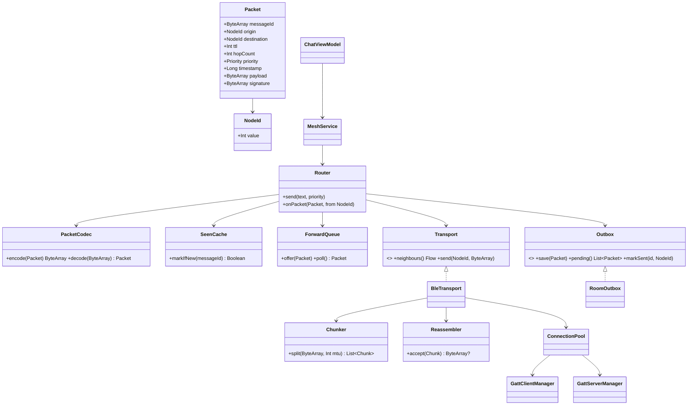

# DROIDRUSH 2026 — Abstract draft (Leyline)

> Draft content for the official template (CodeSangam-Abstract-Droidrush.docx). Fill the team block,
> review, then export as PDF named `TeamName_Year_Droidrush_2026.pdf`.

**Team:** <team name>
**Team ID:** <from CodeSangam website>

**Team Info**
- Member 1: <name> (<reg no>, <branch>, arnavraj-7, <discord>)
- Member 2: <name> (<reg no>, <branch>, <github>, <discord>)
- Member 3: <name> (<reg no>, <branch>, <github>, <discord>)

---

## Description of the problem

When a flood, earthquake or grid failure takes down cell towers and Wi-Fi, phones become isolated
even when people are a few hundred metres apart. Most people still carry a phone with Bluetooth Low
Energy (BLE), which needs no infrastructure. A single BLE link reaches only ~10–30 m indoors, but a
chain of phones can carry a message much further if each one relays it.

**Leyline** turns every phone into a relay node in a delay-tolerant mesh. A message from phone A
reaches phone C through phone B, even if A and C are never in range of each other. If no path
exists right now, the message is stored and forwarded the moment a neighbour appears. It works in
airplane mode with only Bluetooth on, and SOS messages always travel ahead of ordinary chat.

**App name:** Leyline

## Process flow of the app

1. **First launch:** the app generates a random 32-bit node ID and stores it. BLE addresses rotate
   every few minutes for privacy, so all routing uses this ID instead.
2. **Permissions:** Bluetooth scan/advertise/connect (Android 12+) or location (Android 11 and below),
   plus notifications. The app explains each one before asking.
3. **Join the mesh:** a foreground service starts advertising a shared Leyline service UUID with the
   node ID, scans for other Leyline nodes, and connects to nearby ones as a GATT client while running
   its own GATT server.
4. **Send:** the user writes a message (<280 characters) or presses SOS. The router gives it a unique
   message ID, a TTL (3–5 hops) and a priority, and saves it to the outbox before anything is sent.
5. **Transmit:** the packet is encoded in our binary format, split into chunks that fit the negotiated
   MTU (~180 bytes), and written to every connected neighbour.
6. **Relay:** each receiving node reassembles the chunks, checks the message ID against its seen-set,
   drops duplicates, delivers it locally if it is the destination or a broadcast, decrements TTL and,
   if TTL > 0, forwards it to all neighbours except the one it came from.
7. **Store and forward:** if no neighbour is connected, the message waits in the outbox. When a node
   reconnects, its outbox is replayed to the new neighbour.
8. **Display:** each message shows sender, timestamp and hop telemetry (hop count and the path of
   node IDs).

## Features announcement

**Foundation (pass tier)**
- BLE discovery: foreground advertising + scanning on a shared service UUID; GATT connections with
  chunked writes sized from the negotiated MTU.
- Store-and-forward flood router: message-ID deduplication, TTL 3–5, persistent outbox replayed on
  reconnect.
- Multi-hop SOS: 1-hop and 2-hop SOS payloads (<280 chars) showing sender, timestamp and hop path.
- Disaster mode: full operation in airplane mode with Bluetooth on.

**Victory tier**
- Background relay in a foreground service with a priority queue (SOS before chat).
- Chunked long-message reassembly, automatic reconnect with backoff, SOS beacon mode, and message
  signing so relays cannot forge a sender.
- Wi-Fi Direct escalation for large payloads; 4+ node broadcast-storm stress test.

**Our additions beyond the problem statement**
- **Location in every SOS.** GPS needs no network and works in airplane mode, so each SOS carries
  coordinates and accuracy. Receivers see distance and a compass bearing to the sender, so rescuers
  know where to go, not just that someone needs help.
- **Delivery receipts.** Acknowledgements travel back along the reverse path, so the sender sees
  "SOS reached 4 people, nearest 2 hops away" instead of hoping.
- **Live mesh map.** A real-time graph of nearby nodes, link strength and the path each message
  took, so the mesh is visible, not a black box.
- **Battery-aware relaying.** Phones low on battery relay less and announce it; healthy phones carry
  more of the load, so the mesh doesn't drain one person's phone.
- **One-tap SOS anywhere.** A Quick Settings tile and a lock-screen-safe notification action send SOS
  without opening the app.
- **Mesh health dashboard.** Live delivery rate, latency, duplicates suppressed and bytes relayed:
  measured numbers, not claims.

**Engineering extras**
- Topology mode: a node can ignore chosen node IDs, forcing multi-hop paths in a small room for
  demos and tests (always shown in the UI so it is never hidden).
- JVM simulator that runs dozens of virtual nodes over the same routing core to measure delivery rate,
  duplicate rate and latency.
- In-app test log for the multi-device physical test record.

## External libraries / APIs

| Need | Chosen | Alternatives considered | Why |
|---|---|---|---|
| GATT client/server | **Nordic Android-BLE-Library** (+ `ble-ktx` coroutine extensions) | Raw Android BLE APIs; Kable; Nordic's newer Kotlin BLE library | Android allows one GATT operation at a time per connection, and its stack has phone-specific failures (status 133, stale service cache). Nordic's library queues operations and handles retries and MTU negotiation, is maintained by Nordic Semiconductor (a BLE chip maker), and supports **both** client and server roles. Kable only supports the client role, which a mesh can't use. Nordic's Kotlin rewrite is still in beta. Raw APIs would mean re-solving problems the library already solves, time better spent on routing. |
| Advertising & scanning | **Android platform APIs** (`BluetoothLeAdvertiser`, `BluetoothLeScanner`) | Nordic scanner compat library | The platform APIs are enough for minSdk 26 and give direct control of advertising payload and scan settings. |
| Local storage | **Room** (SQLite) | Raw SQLite; SQLDelight | The PS needs an SQLite outbox. Room adds compile-time-checked queries, Flow-based observation for the UI and transactions, and is maintained by Google. SQLDelight fits multiplatform projects; we are Android-only. |
| Concurrency | **Kotlin coroutines + Flow** | RxJava; threads + callbacks | Structured concurrency cancels work cleanly when connections drop; Flow streams connection state and messages to the UI. It's the current Android standard. |
| UI | **Jetpack Compose + Material 3** | XML Views | Declarative UI that redraws from state, less code, and Google's recommended toolkit. |
| Packet encoding | **Custom binary format** | Protocol Buffers; JSON | Every byte counts in a ~180-byte chunk. JSON is too large; Protobuf adds a dependency and hides the wire layout we must document. Our own format is fully specified in the README. |
| Dependency wiring | **Manual (one AppContainer)** | Hilt; Koin | Small app, small team, one-week sprint. Manual wiring has no generated code and no runtime surprises. |
| Testing | **JUnit + kotlinx-coroutines-test** | — | Standard JVM testing for the pure-Kotlin routing core and simulator. |

All libraries are open source under permissive licences. Every library and AI tool used is listed in
the README.

## Core engineering architecture

### Infrastructure layout & data flow

There is no server. Every phone runs the same four layers:

```
┌──────────────────── Phone (one mesh node) ────────────────────┐
│ UI (Compose)  ──▶  ViewModel  ──▶  MeshService (foreground)   │
│                                        │                       │
│                         mesh-core: Router · Dedup · TTL ·      │
│                         PriorityQueue · Codec · Chunker        │
│                                        │                       │
│        Room DB (outbox, seen-set,      │      mesh-ble: GATT   │
│        message history)  ◀─────────────┴────▶ client + server, │
│                                               advertise, scan  │
└────────────────────────────────────────────────┬──────────────┘
                                                  │ BLE radio
                               neighbours ◀───────┴───────▶ neighbours
```

When a user sends an SOS: UI → ViewModel → MeshService → Router assigns ID, TTL and priority →
**the outbox row is committed in Room first** → Codec encodes → Chunker splits by MTU → GATT writes to
each neighbour. On receive, the reverse runs: chunks → Reassembler → Codec → Router (dedup → deliver
→ forward). The routing core (`mesh-core`) is pure Kotlin with no Android code. The same code runs on
the phone and in the JVM simulator, which is how routing is tested at scale.

### Resource perspective: what happens under load

In a mesh, "heavy load" means many phones in one place all rebroadcasting, e.g. 20 people in a
shelter with everyone forwarding every message. Unmanaged, this is a **broadcast storm**: each message
is retransmitted by every node, the radios saturate and SOS messages get lost in the noise. Our design
bounds every resource:

- **Radio:** dedup means each node forwards a message at most once. Each rebroadcast waits a small
  random delay, and a node skips forwarding if it has already heard enough neighbours forward the same
  message (counter-based suppression).
- **Connections:** the connection pool keeps a capped number of neighbours, preferring the strongest
  signal. This protects battery and works within the per-phone connection limit.
- **Memory:** the seen-set is a bounded LRU cache with expiry, so it cannot grow without limit on a
  long-running relay.
- **Queue:** a bounded priority queue. SOS is never dropped; when full, the oldest low-priority chat
  is evicted first.
- **Battery:** scanning runs in duty cycles rather than continuously, and the service runs as a
  "connected device" foreground service so Android does not kill it.

### Naive way vs our way

**1. Forwarding messages**
- *Naive:* rebroadcast every packet you receive. Two nodes in range forward the same message to each
  other forever; in a dense group, traffic grows with every hop until links saturate.
- *Ours:* every packet carries a unique message ID and a TTL. Nodes drop IDs they have already seen,
  decrement TTL, never send back to the neighbour they received from, and suppress redundant
  rebroadcasts.
- *Why it wins:* each node transmits each message at most once and no message travels more than its
  TTL in hops. Total traffic is bounded and loops are impossible. The README gives the proof.

**2. Writing to BLE connections**
- *Naive:* call GATT write for each chunk as soon as it's ready. Android allows only one GATT
  operation in flight per connection; the second call fails silently and chunks are lost.
- *Ours:* a per-connection serial operation queue (Nordic library) with retry and exponential backoff
  on known failure codes (8 timeout, 22 local termination, 133 generic error, all seen in our device
  tests).
- *Why it wins:* every chunk is written exactly in order or retried; a flaky link degrades latency
  instead of corrupting messages.

**3. Not losing messages**
- *Naive:* keep pending messages in an in-memory list. If Android kills the app or the phone
  restarts, every undelivered SOS is gone.
- *Ours:* write-ahead persistence. A message is committed to the Room outbox before its first
  transmission. Message ID is the primary key, so retries and duplicates cannot insert twice
  (idempotent). Delivery state per neighbour is tracked and replayed on reconnect.
- *Why it wins:* a message survives process death, reboot and long disconnection; store-and-forward
  resumes exactly where it stopped.

**4. Identifying nodes**
- *Naive:* use the Bluetooth MAC address as the node identity. Our nRF Connect tests showed the same
  phone appearing under three different addresses within half an hour, because Android rotates them
  for privacy. Dedup and routing keyed on the address break.
- *Ours:* a persistent random node ID inside every advertisement and packet.
- *Why it wins:* stable identity independent of the radio layer, which also makes signing possible.

**5. Packet size**
- *Naive:* assume a fixed size, or hard-code the 20-byte default payload. Our tests measured MTU 517 on
  an Android 14+ phone and 247 on an older one.
- *Ours:* chunk size comes from the MTU actually negotiated for each connection (MTU − 3), with a ~180
  byte default that fits every phone tested.
- *Why it wins:* works across old and new phones without per-device configuration.

### Feasibility already verified

Before planning, we tested three Android phones (one month to ~7 years old) with Nordic's nRF Connect:
all three ran both GATT server and client roles, and a 183-byte payload crossed in a single write. We
have 5–6 Android phones in total for multi-hop and 4+ node stress tests.

## Class diagram

_Render this as an image for the PDF._


